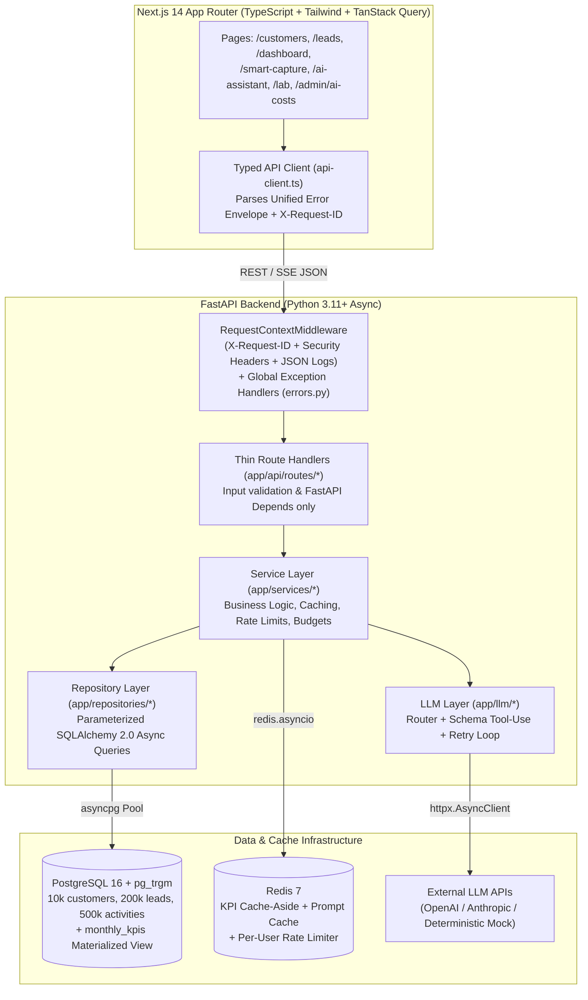
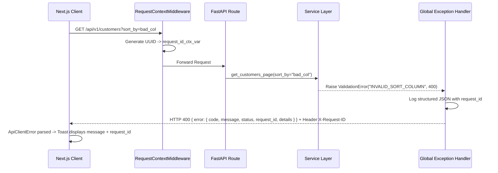

# LeadPulse System Architecture (`ARCHITECTURE.md` — Concept 10)

LeadPulse is designed as a **layered, testable, production-grade monorepo** where every layer has a single responsibility and zero business logic leaks into HTTP route handlers or UI components.

---

## 1. High-Level System Architecture Diagram

---

## 2. Backend Layered Responsibility Rules

| Layer | Directory | Allowed Responsibilities | Forbidden in This Layer |
| :--- | :--- | :--- | :--- |
| **API Routes** | `backend/app/api/routes/` | Parse query/body via Pydantic, resolve `Depends(get_db_session)` / `Depends(get_current_user)`, call a Service method, return typed schema. | Raw SQL/ORM queries, Redis calls, business branching, `try/except HTTPException` boilerplate. |
| **Services** | `backend/app/services/` | Domain logic, cache-aside orchestration, rate-limit/budget checks, calling repositories and LLM client. | HTTP status codes, raw `Request`/`Response` manipulation, unparameterized SQL. |
| **Repositories** | `backend/app/repositories/` | Parameterized SQLAlchemy 2.0 queries, column whitelisting, cursor encoding/decoding, `selectinload` eager loading. | HTTP exceptions, business policy decisions. |
| **LLM Module** | `backend/app/llm/` | Provider abstraction (`OpenAI`, `Anthropic`, `mock`), `ExtractedLead` JSON schema generation, fence stripping, validation retry loop, model routing. | Direct database mutations. |
| **Core** | `backend/app/core/` | `Settings` (`.env`), `AppError` hierarchy & global handlers, `X-Request-ID` middleware, structured JSON logging, JWT + bcrypt security. | Feature-specific logic. |

---

## 3. Request Lifecycle & Error Correlation Flow

