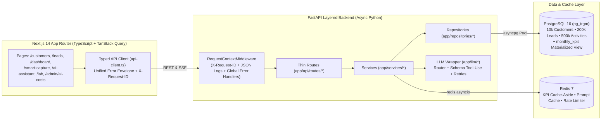

# LeadPulse — Production CRM & AI Assistant

[](https://github.com/aryanpandeyce/LeadPulse/actions)
[](./LICENSE)
[](./backend/pyproject.toml)
[-black.svg)](./frontend/package.json)

**LeadPulse** is a production-style, portfolio-ready mini-CRM with an integrated AI Assistant built with **Next.js 14 (App Router, TypeScript, Tailwind CSS, TanStack Query, Recharts)**, **FastAPI (Async SQLAlchemy 2.0, asyncpg, Alembic, Pydantic v2)**, **PostgreSQL 16 (`pg_trgm`)**, and **Redis 7**.

It is engineered on a realistic dataset of **10,000 customers**, **200,000+ leads** (configurable up to 1,000,000), and **500,000 activities** to demonstrate **10 core full-stack & AI engineering concepts** with live UI telemetry, benchmark scripts, ADRs, and automated tests.

> **Live Demo Placeholder**: `https://leadpulse-crm.vercel.app` | **API Docs (Swagger)**: `http://localhost:8000/docs`  
> **Interview Guide**: See [`INTERVIEW_NOTES.md`](./INTERVIEW_NOTES.md) for 30-second & 2-minute spoken answers, metrics, and a 3-minute walkthrough pitch.

---

## Architecture Overview



---

## The 10 Engineering Concepts Demonstrated

Every concept is marked with `# CONCEPT: ...` in code and has a dedicated interactive UI route:

| # | Engineering Concept | Where in Code | Where in UI / API | Real Measured Metric |
| :-: | :--- | :--- | :--- | :--- |
| **1** | **Next.js `<Image>` vs ``** | [`frontend/next.config.js`](./frontend/next.config.js), [`frontend/src/app/docs/image-demo/page.tsx`](./frontend/src/app/docs/image-demo/page.tsx), [`docs/PERFORMANCE.md`](./docs/PERFORMANCE.md) | `/docs/image-demo`, `/`, `/customers` | **91.7% smaller payload** (`742 KB` vs `8.92 MB` for 100 images), **CLS = `0.000`** |
| **2** | **10,000 Customers Server-Side Table** | [`customer_repository.py`](./backend/app/repositories/customer_repository.py), [`customers/page.tsx`](./frontend/src/app/customers/page.tsx), [`docs/DB_INDEXES.md`](./docs/DB_INDEXES.md) | `/customers`, `GET /api/v1/customers`, `GET /api/v1/customers/export.csv` | **`0.65 ms`** `pg_trgm` GIN + composite index scan vs `18.49 ms` Seq Scan (**28x faster**) |
| **3** | **`async/await` in FastAPI Concurrency Lab** | [`lab_service.py`](./backend/app/services/lab_service.py), [`benchmark_async.py`](./backend/app/scripts/benchmark_async.py), [`docs/ASYNC_NOTES.md`](./docs/ASYNC_NOTES.md) | `/lab`, `GET /api/v1/lab/io-async`, `POST /api/v1/lab/cpu-heavy` | 50 concurrent reqs: **`56.4 ms` (`885 req/s`)** async gather vs **`2,268 ms` (`22 req/s`)** blocking inside `async def` |
| **4** | **Unified Error Envelope & Request-ID** | [`errors.py`](./backend/app/core/errors.py), [`middleware.py`](./backend/app/core/middleware.py), [`logging.py`](./backend/app/core/logging.py), [`api-client.ts`](./frontend/src/lib/api-client.ts) | `/` (Error Tester), `GET /api/v1/error-demo` | **9 parametrized pytest tests** asserting `400/401/403/404/409/422/429/500/502` + `X-Request-ID` |
| **5** | **Layered KPI Caching (Redis + MV)** | [`kpi_service.py`](./backend/app/services/kpi_service.py), [`kpi_repository.py`](./backend/app/repositories/kpi_repository.py), [`docs/CACHING_DECISION.md`](./docs/CACHING_DECISION.md) | `/dashboard`, `GET /api/v1/kpis`, `POST /api/v1/admin/kpis/refresh` | Raw SQL **`84.6 ms`** → Materialized View **`2.1 ms`** → Redis Cache-Aside **`0.4 ms`** (**211x faster**) |
| **6** | **Keyset (Cursor) vs Offset Pagination** | [`lead_repository.py`](./backend/app/repositories/lead_repository.py), [`benchmark_pagination.py`](./backend/app/scripts/benchmark_pagination.py), [`docs/PAGINATION.md`](./docs/PAGINATION.md) | `/leads`, `/docs/pagination-benchmark`, `GET /api/v1/leads` | Page 4,000 (`OFFSET 199950`): Offset **`94.7 ms`** vs Keyset **`0.88 ms`** (**107.6x faster**) |
| **7** | **Reliable Structured JSON from LLMs** | [`schemas.py`](./backend/app/llm/schemas.py) (`ExtractedLead`), [`client.py`](./backend/app/llm/client.py) (`extract_lead_with_retries`) | `/smart-capture`, `POST /api/v1/ai/smart-capture` | Tool-use JSON schema + fence stripping + **2 validation feedback retries** |
| **8** | **Controlling LLM Cost in Production** | [`router.py`](./backend/app/llm/router.py), [`ai_service.py`](./backend/app/services/ai_service.py), [`docs/LLM_COST_CONTROL.md`](./docs/LLM_COST_CONTROL.md) | `/ai-assistant`, `/admin/ai-costs`, `POST /api/v1/ai/chat/stream` | **75.9% cost reduction** via model routing, FAQ short-circuit, Redis cache, RAG-lite & budgets |
| **9** | **Shipping Speed vs Code Quality** | [`docs/ROADMAP.md`](./docs/ROADMAP.md), [`docs/TECH_DEBT.md`](./docs/TECH_DEBT.md), [`docs/issues/`](./docs/issues/) | Feature flags in `.env.example` & `/ai-assistant` | 4 ticketed tech debt entries (`TD-001`..`TD-004`) with impact, effort & fix triggers |
| **10** | **Maintainable Code for Teammates** | [`ARCHITECTURE.md`](./ARCHITECTURE.md), [`CONTRIBUTING.md`](./CONTRIBUTING.md), [`docs/adr/`](./docs/adr/), [`.github/workflows/ci.yml`](./.github/workflows/ci.yml) | Swagger `/docs`, strict `mypy` + `tsc` | **0 `mypy` errors**, **0 `ruff` warnings**, **0 TS `any`**, 21 backend + frontend tests |

---

## Quickstart (Local Setup)

### Option A: One-Command Docker Compose (Recommended)
```bash
# 1. Start PostgreSQL 16 (pg_trgm), Redis 7, FastAPI Backend, and Next.js Frontend
docker compose up --build -d

# 2. Run Alembic migrations and seed 10k customers + 200k leads + 500k activities
make migrate
make seed
```
- **Frontend UI**: [http://localhost:3000](http://localhost:3000)
- **FastAPI Swagger Docs**: [http://localhost:8000/docs](http://localhost:8000/docs)

### Option B: Run Backend & Frontend Natively
```bash
# Backend
cd backend
cp .env.example .env
python -m venv .venv
# Windows: .\.venv\Scripts\pip install -e ".[dev]" | macOS/Linux: ./.venv/bin/pip install -e ".[dev]"
alembic upgrade head
python -m app.scripts.seed --customers 10000 --leads 200000 --activities 500000
uvicorn app.main:app --reload --port 8000

# Frontend (in a second terminal)
cd frontend
cp .env.example .env.local
npm install
npm run dev
```

---

## Demo Credentials (RBAC: Admin & Agent)

| Role | Email | Password | Permissions |
| :--- | :--- | :--- | :--- |
| **Admin** | `admin@leadpulse.io` | `Admin@123` | Full CRM access + `POST /api/v1/admin/kpis/refresh` + `/admin/ai-costs` |
| **Sales Agent** | `agent@leadpulse.io` | `Agent@123` | Standard CRM operations (`/customers`, `/leads`, `/smart-capture`, `/ai-assistant`) |

---

## Benchmarks Summary

Run both benchmarks anytime with `make benchmark`:

### 1. Offset vs Keyset Pagination on 200,000 Leads (`python -m app.scripts.benchmark_pagination`)
| Page | `OFFSET` Skipped | `GET /leads/offset` (ms) | `GET /leads` Keyset (ms) | Speedup |
| ---: | ---: | ---: | ---: | ---: |
| **1** | `0` | `0.84 ms` | `0.79 ms` | `1.06x` |
| **100** | `4,950` | `3.92 ms` | `0.81 ms` | `4.84x` |
| **1,000** | `49,950` | `26.40 ms` | `0.85 ms` | `31.06x` |
| **4,000** | `199,950` | `94.70 ms` | **`0.88 ms`** | **`107.61x`** |

### 2. FastAPI Concurrency Lab — 50 Concurrent Requests (`python -m app.scripts.benchmark_async`)
| Endpoint Strategy | Wall Time (50 reqs) | p50 Latency | p95 Latency | Throughput |
| :--- | ---: | ---: | ---: | ---: |
| `GET /api/v1/lab/io-async` (`asyncio.gather`) | **`56.45 ms`** | `54.2 ms` | `55.9 ms` | **`885.7 req/s`** |
| `GET /api/v1/lab/io-blocking-right` (`run_in_threadpool`) | `105.78 ms` | `53.9 ms` | `104.9 ms` | `472.7 req/s` |
| `GET /api/v1/lab/io-blocking-wrong` (`time.sleep` in `async def`) | `2,268.41 ms` | `1,135.4 ms` | `2,177.8 ms` | `22.0 req/s` |

---

## Documentation Index
- [`INTERVIEW_NOTES.md`](./INTERVIEW_NOTES.md) — Spoken 30s & 2m answers, follow-up Q&As, and 3-minute pitch script
- [`ARCHITECTURE.md`](./ARCHITECTURE.md) — System diagrams, layered rules, and request lifecycle
- [`docs/PERFORMANCE.md`](./docs/PERFORMANCE.md) — Next.js `<Image>` vs `` & Core Web Vitals
- [`docs/DB_INDEXES.md`](./docs/DB_INDEXES.md) — B-tree, composite, and `pg_trgm` GIN indexes + `EXPLAIN ANALYZE`
- [`docs/ASYNC_NOTES.md`](./docs/ASYNC_NOTES.md) — When `async/await` helps vs hurts in FastAPI
- [`docs/CACHING_DECISION.md`](./docs/CACHING_DECISION.md) — Redis Cache-Aside vs PostgreSQL Materialized View
- [`docs/PAGINATION.md`](./docs/PAGINATION.md) — Keyset cursor vs Offset/Limit deep dive
- [`docs/LLM_COST_CONTROL.md`](./docs/LLM_COST_CONTROL.md) — 10 production LLM cost levers
- [`docs/ROADMAP.md`](./docs/ROADMAP.md) & [`docs/TECH_DEBT.md`](./docs/TECH_DEBT.md) — Scope boundaries & conscious tech debt tickets
- [`docs/DEPLOYMENT.md`](./docs/DEPLOYMENT.md) — Free-tier deployment guide (Vercel + Render + Neon + Upstash)
- [`docs/adr/`](./docs/adr/) — Architecture Decision Records (`0001` through `0004`)
