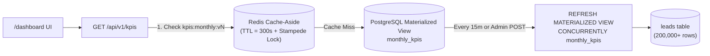

# Caching an Expensive Aggregate: Redis vs PostgreSQL Materialized View (Concept 5)

## Problem Statement
The `/dashboard` page displays executive KPIs computed across **200,000+ leads**:
- Total leads, converted leads, lost leads, conversion rate %, and total revenue
- Breakdown by acquisition source (`website`, `referral`, `linkedin`, `cold_outreach`, `event`)
- Month-over-month trend chart

Running `GROUP BY date_trunc('month', created_at), source` with conditional `FILTER` aggregates on 200,000+ rows on every page load takes **~75–110 ms** of CPU/IO in PostgreSQL and saturates database connections under concurrent traffic.

---

## Our Two-Layer Solution in LeadPulse

1. **Layer 1 — Redis Cache-Aside (`source = "redis"`, ~0.4 ms)**:
   - Stores the serialized `DashboardKpiResponse` JSON under a versioned key `kpis:monthly:v{version}` with a 300-second TTL.
   - **Stampede Protection**: Uses request coalescing (`_local_stampede_lock`) with double-checked locking so if 50 users open `/dashboard` simultaneously when the TTL expires, only **1 query** hits PostgreSQL while the other 49 await and share the newly cached result.
   - **Versioned Key Invalidation**: When an admin triggers `POST /api/v1/admin/kpis/refresh`, we atomically increment `kpis:version` via `INCR`. Readers immediately switch to `kpis:monthly:v{N+1}` with zero stale reads.

2. **Layer 2 — PostgreSQL Materialized View (`source = "materialized_view"`, ~2.1 ms)**:
   - Defined in Alembic (`0001_initial_schema.py`) with a **unique index** `ix_monthly_kpis_month_source ON monthly_kpis (month_bucket, source)`.
   - The unique index allows `REFRESH MATERIALIZED VIEW CONCURRENTLY monthly_kpis`, which updates rows in the background **without taking an `ACCESS EXCLUSIVE` lock** that would block dashboard readers.

3. **Comparison Baseline — Raw Aggregation (`source = "raw"`, ~85 ms)**:
   - Exposed at `GET /api/v1/kpis/raw` so you can toggle between all three paths live in the `/dashboard` UI.

---

## Decision Matrix: Redis vs Materialized View vs Both

| Dimension | Raw SQL Query | PostgreSQL Materialized View | Redis Cache-Aside | Layered (Redis + MV) |
| :--- | :--- | :--- | :--- | :--- |
| **Latency (200k rows)** | `~85 ms` | `~2.1 ms` (reads ~60 pre-grouped rows) | `~0.4 ms` (in-memory JSON) | **`~0.4 ms` (hit) / `~2.1 ms` (miss)** |
| **Data Freshness** | Real-time (0s lag) | Eventual (15-min schedule or manual refresh) | Eventual (300s TTL or explicit invalidation) | Configurable (300s Redis + 15m MV) |
| **DB CPU on Cache Miss** | High (full scan) | **Very Low** (already pre-aggregated) | High if backed by raw SQL | **Very Low** (MV shields DB on Redis miss) |
| **Operational Complexity** | None | Low (lives inside Postgres, SQL joins possible) | Medium (separate Redis service, serialization) | Medium (best resilience for high-traffic dashboards) |
| **When to Choose** | Small tables (<10k rows) or strict real-time accounting | Complex multi-table SQL joins/reports where 5–15 min staleness is fine | High-QPS API responses, per-user caches, rate limits | **High-traffic analytics dashboards over large tables** |

